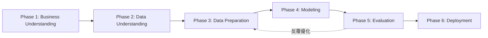

# AIoT-DA L6: 50 Startups Profit Prediction using Multiple Linear Regression

[](https://www.python.org/)
[](https://scikit-learn.org/)
[](LICENSE)
[](https://github.com/mumumush/1014)

---

## 📌 專案簡介 (Project Overview)

本專案基於 **CRISP-DM (Cross-Industry Standard Process for Data Mining)** 跨產業資料探勘標準流程，針對 Kaggle 經典的 **50 Startups** 資料集進行多元線性回歸（Multiple Linear Regression）建模與分析。

目標在於探討企業各項支出（研發費用 R&D Spend、行政管理費用 Administration、行銷費用 Marketing Spend）以及所在州別（State）對新創公司最終獲利（Profit）的影響，並透過 **前向特徵選取（Forward Feature Selection）** 評估不同特徵子集對模型預測能力的表現，最後將最佳模型壓縮部署封裝。

---

## 🌐 線上展示與程式碼庫 (Demo Site & Repository)

- **🚀 線上互動展示網站 (Live Web Demo)**: [https://mumumush.github.io/1014/](https://mumumush.github.io/1014/)
- **GitHub 專案倉庫 (Repository)**: [https://github.com/mumumush/1014](https://github.com/mumumush/1014)
- **Git Clone 指令**:
  ```bash
  git clone https://github.com/mumumush/1014.git
  ```

---

## 🔄 CRISP-DM 六大實作階段 (Methodology & Workflow)



### Phase 1: Business Understanding (商業理解)
- **核心目標**：精準預測新創公司利潤，協助創投與經營團隊進行預算配置與決策評估。
- **利益關係人**：創業投資人（VC）、企業高階決策主管、財務分析師。
- **衡量指標**：高決定係數（$R^2 \ge 0.90$）以及低均方根誤差（RMSE）與平均絕對誤差（MAE）。

### Phase 2: Data Understanding (資料理解)
- 載入 50 家新創公司的營運數據，檢視各欄位型態、統計分佈並進行品質校驗（確認無缺失值）。
- **特徵欄位**：
  - `R&D Spend`: 研發支出（數值型）
  - `Administration`: 行政管理支出（數值型）
  - `Marketing Spend`: 行銷支出（數值型）
  - `State`: 所在州（類別型：New York, California, Florida）
- **目標變數 (Target)**：
  - `Profit`: 公司獲利（數值型）

### Phase 3: Data Preparation (資料準備)
1. **特徵與目標變數分離**：獨立出特徵矩陣 $X$ 與目標標籤 $y$。
2. **類別型變數編碼 (One-Hot Encoding)**：
   - 對 `State` 進行獨熱編碼。
   - 啟用 `drop_first=True`，避開 **虛擬變數陷阱 (Dummy Variable Trap)**，消除完全共線性（Multicollinearity）。
3. **資料集切分 (Train/Test Split)**：
   - 訓練集：80%（40 筆樣本）
   - 測試集：20%（10 筆樣本）
   - 固定隨機種子：`random_state=0`

### Phase 4: Modeling (模型建立)
使用 `scikit-learn` 中的 `LinearRegression` 演算法進行擬合：
$$\hat{y} = b_0 + b_1 X_1 + b_2 X_2 + \dots + b_k X_k$$

**回歸係數與截距項結果**：
| 特徵 (Feature) | 係數 (Coefficient) | 意義說明 |
|:---|---:|:---|
| **截距項 (Intercept, $b_0$)** | `42,554.17` | 基礎預期利潤基準值 |
| **R&D Spend** | `+0.7735` | 研發支出每增加 1 元，利潤預期增加約 0.77 元（最顯著） |
| **Administration** | `+0.0329` | 行政支出對利潤影響極低 |
| **Marketing Spend** | `+0.0366` | 行銷支出對利潤有正向微幅貢獻 |
| **State_Florida** | `-959.28` | 相對 California 州之虛擬變數基準調整 |
| **State_New York** | `+699.37` | 相對 California 州之虛擬變數基準調整 |

### Phase 5: Evaluation (模型評估與前向特徵選取)

#### 1. 全變數模型評估指標
- **$R^2$ (決定係數)**: `0.934707`（可解釋測試集 93.47% 的利潤變異）
- **MAE (平均絕對誤差)**: `$7,514.29`
- **MSE (均方誤差)**: `$83,502,864.03`
- **RMSE (均方根誤差)**: `$9,137.99`
- **泛化分析**：訓練集 $R^2 = 0.9502$，測試集 $R^2 = 0.9347$，兩者差距小於 2%，模型表現穩健無明顯過擬合（Overfitting）。

#### 2. 前向逐步特徵選取 (Forward Feature Selection)
以「最小化 RMSE」與「最大化 $R^2$」為目標，評估 1 到 5 個特徵的最佳組合：

| Number of Features | Selected Features | RMSE | R-squared |
|---:|:---|---:|---:|
| 1 | `R&D Spend` | 8274.87 | 0.946459 |
| **2 (最佳組合)** | **`R&D Spend`, `Marketing Spend`** | **8198.80** | **0.947439** |
| 3 | `R&D Spend`, `Marketing Spend`, `State_New York` | 8309.06 | 0.946015 |
| 4 | `R&D Spend`, `Marketing Spend`, `State_New York`, `State_Florida` | 8409.92 | 0.944697 |
| 5 | `R&D Spend`, `Marketing Spend`, `State_New York`, `State_Florida`, `Administration` | 9137.99 | 0.934707 |

> 💡 **關鍵洞見**：
> - 僅選取 `R&D Spend` 一項特徵，$R^2$ 即達 **0.9465**。
> - 最佳模型為 **2 個特徵（R&D Spend + Marketing Spend）**，RMSE 達到最低點 **8,198.80** 且 $R^2$ 達全域最高 **0.9474**。
> - 加入行政管理與地理州別變數反而引入雜訊，導致 RMSE 攀升。

#### 3. 預測視覺化圖表
已輸出高品質實際值與預測值對比圖：`actual_vs_predicted.png`。

---

### Phase 6: Deployment (模型部署與封裝)
- 使用 `gzip` 配合 `pickle` 封裝產出輕量化模型包：`startup_lr_model.pkl.gz`。
- 支援產線系統與 Web API 直接載入與推論。
- **推論驗證**：
  - 輸入：R&D $160,000 / Admin $130,000 / Marketing $300,000 / Florida = 1
  - 預測利潤：**$180,607.64**

---

## 📁 專案檔案結構 (Project Structure)

```text
111/
├── 50_Startups.csv                 # 50 家新創公司原始資料集
├── 50_startup_crisp_dm.py          # CRISP-DM 完整可執行 Python 腳本
├── 50_Startup_CRISP_DM.ipynb       # 具備說明與視覺化的 Jupyter Notebook
├── actual_vs_predicted.png         # 模型預測 vs 實際散布圖
├── startup_lr_model.pkl.gz         # 已訓練完成之壓縮部署模型
└── README.md                       # 專案總結與說明文檔
```

---

## 🚀 快速上手 (Quick Start)

### 1. 安裝必要套件
```bash
pip install pandas numpy scikit-learn matplotlib tabulate
```

### 2. 執行 Python 腳本
```bash
python 50_startup_crisp_dm.py
```

### 3. 開啟 Jupyter Notebook 互動學習
在 VS Code 或 Jupyter Lab 中開啟：
```bash
jupyter notebook 50_Startup_CRISP_DM.ipynb
```

---

## 🙏 致謝與參考資料 (Acknowledgments & References)

本專案之資料、方法論與理論基礎參考以下學術教材與開源資源，特此致謝：

1. **Kaggle 50 Startups Dataset & Notebook**:
   - [50 Startups Linear Regression by Akash](https://www.kaggle.com/code/akash17/50-startups-linearregression)
2. **開源資料來源 (Data Sources)**:
   - [GaneshSparkz Gist Raw 50_Startups.csv](https://gist.githubusercontent.com/GaneshSparkz/b5662effbdae8746f7f7d8ed70c42b2d/raw/faf8b1a0d58e251f48a647d3881e7a960c3f0925/50_Startups.csv)
   - [Hari Mittapalli GitHub Multiple Linear Regression](https://github.com/harimittapalli/Mulitple-Linear-Reggression)
3. **技術文件與教學文章 (Tutorials & Documentation)**:
   - [iT 邦幫忙：機器學習線性回歸範例說明](https://ithelp.ithome.com.tw/m/articles/10299081)
   - [國立聯合大學 陳士杰教授：機器學習演算法與 Meta-heuristic 專題](http://debussy.im.nuu.edu.tw/sjchen/ML_final.html)
   - [Scikit-learn 官方文件：LinearRegression API](https://scikit-learn.org/stable/modules/generated/sklearn.linear_model.LinearRegression.html)
   - [Stack Overflow：Evaluating p-value significance in scikit-learn Linear Regression](https://stackoverflow.com/questions/27928275/find-p-value-significance-in-scikit-learn-linearregression)
